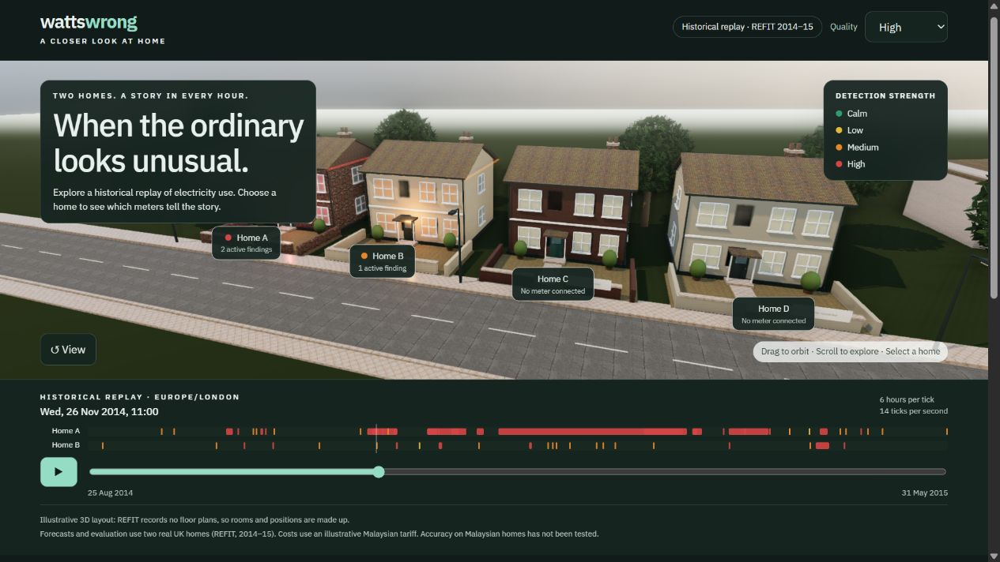
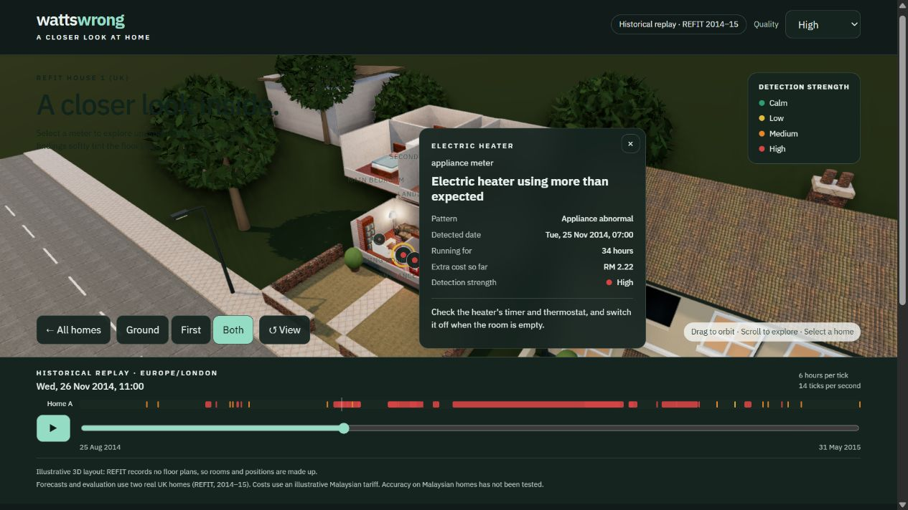

# WattsWrong 3D

**An interactive 3D replay of household electricity anomalies, built on nine months of real smart-meter data.**

WattsWrong forecasts what each meter in a home *should* use, flags sustained deviations as findings, and puts a price on them. This app replays those findings across a 3D street of four real UK homes (REFIT dataset, 2014–15). Walk into a home, see which appliance is misbehaving, how much it is costing and what to check next.





A [walkthrough video](wattswrong-walkthrough-720p-preview.mp4) and the [presentation deck](WattsWrong.pptx) are included in the repository.

## Highlights

- **Real data, scored blind.** 179 findings across 4 homes and 16 meters, produced by a single frozen run over a held-out test window. Nothing was tuned on test data.
- **Explorable 3D scene.** A procedurally built neighbourhood with PBR materials, HDRI lighting, SSAO and selective bloom. Click a home to enter it; each metered appliance sits in its room and glows with its status.
- **Plain-language dashboards.** Each home and meter has its extra cost so far, actual-versus-expected graphs (kWh or RM), possible causes with a way to check each, a calm-streak calendar and day-by-day breakdowns.
- **Replay controls.** Scrub through time, play a window, or jump to Day, Week, Month or All. A full-screen recap tells the story of the whole replay.
- **Accessible and resilient.** Every action is reachable by keyboard. If WebGL or the 3D engine is unavailable, the app falls back to a fully working table, timeline and dashboards.
- **Zero build.** The entire app, including the 81,046-row hourly series, is a single `index.html`.

## How it works

```
REFIT raw CSVs ──► ingest ──► hourly series ──► LightGBM forecast per meter
                                                        │
                                   residual ÷ robust spread = anomaly score
                                                        │
                           persistence rules ──► findings ──► validated JSON exports
                                                                     │
                                                       embedded in index.html ──► 3D replay
```

1. **Forecast.** One LightGBM regressor per meter predicts each hour's usage from features that are at least 24 hours old: hour, weekday, bank holidays, the same hour yesterday and last week, rolling means and a four-week median.
2. **Score.** Each hour's residual is divided by a per-hour robust spread (1.4826 × MAD of out-of-sample residuals).
3. **Detect.** A finding is confirmed when enough high-scoring hours fall within a recent window. It ends after a run of normal hours. Confirmed anomalous hours are replaced by their forecast in the model's history, so a fault never becomes the new normal.
4. **Cost.** Extra cost is the running sum of positive residuals × RM 0.444/kWh. Costs from different meters are never summed, because whole-home and appliance readings overlap.

The design decisions behind each step are recorded in [`backend/docs/adr/`](backend/docs/adr/).

## Results

Results come from the frozen run `20261010T190414Z`, which scored the test window of 31 Jan – 31 May 2015 once, over all four homes.

| Scope | Labelled events found | Precision | Median time to detect | False alarms |
|---|---|---|---|---|
| All meters | 11 of 37 (30%) | 16% | 7.3 h | 5.2 per home per month |
| Whole-home meter only | 4 of 37 (11%) | 9% | 26.5 h | 3.9 per home per month |

Houses 10 and 18 were added after the method was fixed and were scored without any adjustment. Per-meter results and known data caveats are in [`backend/reports/metrics_final.json`](backend/reports/metrics_final.json). One example: House 10's fridge-freezer was replaced partway through the test window. The run's first attempt crashed while writing its output and was re-run once after a serialisation fix, producing bit-identical results. The re-run reason is logged in the metrics file.

## Running the app

Open `index.html` in any modern WebGL2 browser, or serve the folder:

```bash
npx serve .
```

All data is embedded, so the app works from `file://`. three.js, the font and the textures load from CDNs, so the 3D view needs an internet connection. Every external URL lives in one `ASSETS` object at the top of the script, which makes self-hosting a one-place change.

**Controls.** Click a home once for its card and again to go inside. Click a meter twice for its detail. Drag to orbit. Escape steps back out. Tab and Enter work throughout. **Sharper** and **Faster** switch the graphics quality.

**Console API.**

```js
WattsWrong.getState()                       // current derived snapshot
WattsWrong.setTime('2014-11-26T11:00:00Z')  // jump to an hour
WattsWrong.load({ manifest, findings, timeseries })  // replay different data
```

## Backend

`backend/` is the offline Python pipeline that produced the findings. It needs Python 3.12+ and [uv](https://docs.astral.sh/uv/).

```bash
cd backend
uv sync --locked
uv run --locked python -m pytest -q pipeline   # test suite
uv run --locked python -m pipeline.validate    # check exports against the JSON contracts
uv run --locked python -m pipeline.embed       # write exports into ../index.html
```

None of these steps need the raw data. To rebuild the hourly inputs, download the source files below into `backend/data/raw/` and run `pipeline.ingest` for each home:

```bash
uv run --locked python -m pipeline.ingest data/raw/refit/CLEAN_House1.csv house1
```

The frozen run is locked. `pipeline.run final` refuses to run again without a logged `--rerun-reason`.

<details>
<summary>Raw source files and checksums</summary>

| File (under `backend/`) | MD5 | Source |
|---|---|---|
| `data/raw/refit/CLEAN_House1.csv` | `f5336d80c700f866af0d997ea8d39146` | [Zenodo](https://zenodo.org/records/5063428/files/CLEAN_House1.csv?download=1) |
| `data/raw/refit/CLEAN_House3.csv` | `ab6e34ea386eb4563bfcb9762619dc8f` | [Zenodo](https://zenodo.org/records/5063428/files/CLEAN_House3.csv?download=1) |
| `data/raw/refit/CLEAN_House10.csv` | `e442a1b1dc7ce73fae516a000efb1215` | [Strathclyde](https://doi.org/10.15129/9ab14b0e-19ac-4279-938f-27f643078cec), in `CLEAN_REFIT_081116.7z` |
| `data/raw/refit/CLEAN_House18.csv` | `7fbb09fd62860b3aef0c19c545b66342` | [Strathclyde](https://doi.org/10.15129/9ab14b0e-19ac-4279-938f-27f643078cec), in `CLEAN_REFIT_081116.7z` |
| `data/raw/labels/REFIT_anomalies.csv` | `dd96a35285b2b207000650867ace10c2` | [Strathclyde](https://doi.org/10.15129/9729a2a0-11ce-4cce-b0d0-144c483fcb33) |
| `data/raw/labels/README_ICASSP.txt` | `9d0bfaf94c936f215f3e86c357fd5221` | [Strathclyde](https://doi.org/10.15129/9729a2a0-11ce-4cce-b0d0-144c483fcb33) |

</details>

## Project structure

```
index.html                  the complete app: HTML, CSS, JS and embedded data
backend/
  pipeline/                 ingest, model, detection, evaluation, validation, embed (+ tests)
  config/config.json        frozen detector configuration
  contracts/                JSON schemas for the exports
  docs/adr/                 architecture decision records
  reports/                  final metrics and event matches
  web/public/data/          the frozen run's exports
```

## Limitations

- Room layouts and furniture are illustrative. Only the appliance placement reflects each home's real meters.
- Lighting is fixed at golden hour. Rendering is rasterised, not path-traced.
- Gaps in the source data are not filled. Costs cover recorded hours only.
- 60 fps is a target, not a guarantee. The renderer lowers its resolution automatically on slow GPUs.

## Credits and licences

**Data.** REFIT electricity data by David Murray and Lina Stankovic, University of Strathclyde ([Zenodo](https://doi.org/10.5281/zenodo.5063428), [Strathclyde](https://doi.org/10.15129/9ab14b0e-19ac-4279-938f-27f643078cec)), CC BY 4.0. Anomaly annotations by Rashid et al., ICASSP 2019 ([source](https://doi.org/10.15129/9729a2a0-11ce-4cce-b0d0-144c483fcb33)), CC BY 4.0.

**Assets.** HDRI and textures from [Poly Haven](https://polyhaven.com) (CC0): Greg Zaal, Rob Tuytel, Dimitrios Savva, Charlotte Baglioni, Amal Kumar and Fran Calvente. [IBM Plex Sans](https://fonts.google.com/specimen/IBM+Plex+Sans) (SIL OFL 1.1). [three.js](https://threejs.org) (MIT).
